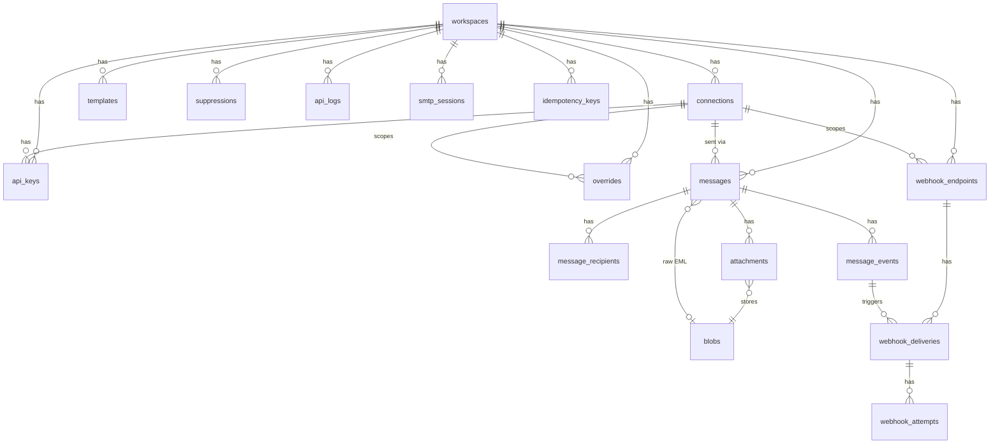

# 2. Database schema (Drizzle ORM)

One `pg-core` schema, used unchanged by `drizzle-orm/node-postgres` and `drizzle-orm/pglite`.
IDs are prefixed, time-sortable strings generated in `core/ids.ts` (`ws_`, `con_`, `msg_`…,
UUIDv7 body). Every row below a workspace cascades on workspace deletion, so deleting an
expired ephemeral workspace is a single `DELETE`.

## Relations at a glance



## `schema/enums.ts`

```ts
import { pgEnum } from 'drizzle-orm/pg-core'

export const connectionKind = pgEnum('connection_kind', ['resend', 'brevo', 'smtp'])
export const messageSource = pgEnum('message_source', ['native', 'resend', 'brevo', 'smtp'])
export const deliveryStatus = pgEnum('delivery_status', [
  'queued', 'sent', 'delivered', 'deferred', 'soft_bounce', 'hard_bounce',
  'complained', 'failed', 'suppressed',
])
export const eventType = pgEnum('event_type', [
  'accepted', 'sent', 'delivered', 'deferred', 'soft_bounce', 'hard_bounce',
  'complained', 'failed', 'suppressed', 'opened', 'clicked',
])
export const eventOrigin = pgEnum('event_origin', ['simulation', 'api', 'ui', 'mcp'])
export const recipientKind = pgEnum('recipient_kind', ['to', 'cc', 'bcc'])
export const apiKeyScope = pgEnum('api_key_scope', ['workspace', 'connection'])
export const suppressionReason = pgEnum('suppression_reason', ['hard_bounce', 'complained', 'manual'])
export const webhookFormat = pgEnum('webhook_format', ['provider', 'unified'])
export const webhookDeliveryStatus = pgEnum('webhook_delivery_status', [
  'pending', 'retrying', 'succeeded', 'failed',
])
export const apiDialect = pgEnum('api_dialect', [
  'native', 'resend', 'brevo', 'admin', 'capture', 'mcp',
])
export const smtpOutcome = pgEnum('smtp_outcome', ['accepted', 'rejected', 'auth_failed', 'error'])
```

## `schema/workspaces.ts`

```ts
import { sql } from 'drizzle-orm'
import { boolean, index, integer, jsonb, pgTable, text, timestamp } from 'drizzle-orm/pg-core'
import type { RateLimitSettings, SimulationSettings } from '@mailsink/contracts'

export const workspaces = pgTable('workspaces', {
  id: text('id').primaryKey(),                                   // ws_…
  slug: text('slug').notNull().unique(),                         // live-the-wod-staging
  name: text('name').notNull(),
  description: text('description'),
  ephemeral: boolean('ephemeral').notNull().default(false),
  idleTtlSeconds: integer('idle_ttl_seconds'),                   // null when persistent
  lastActivityAt: timestamp('last_activity_at', { withTimezone: true }).notNull().defaultNow(),
  // Denormalized last_activity_at + idle_ttl_seconds, maintained by activity.ts,
  // so the GC query is an index range scan.
  expiresAt: timestamp('expires_at', { withTimezone: true }),
  retentionSeconds: integer('retention_seconds').notNull().default(7 * 86_400),
  maxMessages: integer('max_messages'),                          // null = unbounded
  rateLimit: jsonb('rate_limit').$type<RateLimitSettings>(),     // null = unlimited
  simulation: jsonb('simulation').$type<SimulationSettings>().notNull()
    .default(sql`'{"rates":{"delivered":100}}'::jsonb`),
  metadata: jsonb('metadata').$type<Record<string, string>>(),   // e.g. CI run id
  createdVia: text('created_via', { enum: ['ui', 'admin_api'] }).notNull(),
  createdAt: timestamp('created_at', { withTimezone: true }).notNull().defaultNow(),
  updatedAt: timestamp('updated_at', { withTimezone: true }).notNull().defaultNow(),
}, (t) => [
  index('workspaces_expiry_idx').on(t.expiresAt).where(sql`${t.ephemeral}`),
  index('workspaces_picker_idx').on(t.ephemeral, t.name),
])
```

## `schema/connections.ts` and `schema/keys.ts`

```ts
export const connections = pgTable('connections', {
  id: text('id').primaryKey(),                                   // con_…
  workspaceId: text('workspace_id').notNull()
    .references(() => workspaces.id, { onDelete: 'cascade' }),
  name: text('name').notNull(),                                  // "Brevo - Transactionnel"
  kind: connectionKind('kind').notNull(),
  smtpUsername: text('smtp_username').unique(),                  // kind = smtp only
  smtpPasswordHash: text('smtp_password_hash'),                  // scrypt (D11)
  // Per-connection overrides of workspace defaults; null = inherit.
  retentionSeconds: integer('retention_seconds'),
  rateLimit: jsonb('rate_limit').$type<RateLimitSettings>(),
  simulation: jsonb('simulation').$type<Partial<SimulationSettings>>(),
  disabledAt: timestamp('disabled_at', { withTimezone: true }),
  createdAt: timestamp('created_at', { withTimezone: true }).notNull().defaultNow(),
  updatedAt: timestamp('updated_at', { withTimezone: true }).notNull().defaultNow(),
}, (t) => [
  index('connections_workspace_idx').on(t.workspaceId),
  check('connections_smtp_creds', sql`(${t.kind} = 'smtp') = (${t.smtpUsername} is not null)`),
])

export const apiKeys = pgTable('api_keys', {
  id: text('id').primaryKey(),                                   // key_…
  workspaceId: text('workspace_id').notNull()
    .references(() => workspaces.id, { onDelete: 'cascade' }),
  connectionId: text('connection_id')
    .references(() => connections.id, { onDelete: 'cascade' }),
  scope: apiKeyScope('scope').notNull(),                         // D12
  name: text('name'),
  displayPrefix: text('display_prefix').notNull(),               // "msk_live_3f9a…"
  hash: text('hash').notNull().unique(),                         // sha256(key) (D11)
  lastUsedAt: timestamp('last_used_at', { withTimezone: true }),
  revokedAt: timestamp('revoked_at', { withTimezone: true }),
  createdAt: timestamp('created_at', { withTimezone: true }).notNull().defaultNow(),
}, (t) => [
  check('api_keys_scope', sql`(${t.scope} = 'connection') = (${t.connectionId} is not null)`),
])
```

## `schema/overrides.ts`

```ts
import type { OverrideConfig } from '@mailsink/contracts'

export const overrides = pgTable('overrides', {
  id: text('id').primaryKey(),                                   // ovr_…
  workspaceId: text('workspace_id').notNull()
    .references(() => workspaces.id, { onDelete: 'cascade' }),
  connectionId: text('connection_id')                            // null = whole workspace
    .references(() => connections.id, { onDelete: 'cascade' }),
  config: jsonb('config').$type<OverrideConfig>().notNull(),     // rates, rules, latency,
                                                                 // chaos, rateLimit
  activatedVia: eventOrigin('activated_via').notNull(),
  expiresAt: timestamp('expires_at', { withTimezone: true }),    // optional auto-reset
  createdAt: timestamp('created_at', { withTimezone: true }).notNull().defaultNow(),
  resetAt: timestamp('reset_at', { withTimezone: true }),        // null = active
}, (t) => [
  // At most one active override per scope; history is kept for the logs.
  uniqueIndex('overrides_active_scope_uq')
    .on(t.workspaceId, sql`coalesce(${t.connectionId}, '')`)
    .where(sql`${t.resetAt} is null`),
])
```

Resolution order, computed by `simulation/settings-resolver.ts`, field by field:
**connection override > workspace override > connection settings > workspace settings**.
Expired overrides (`expires_at < now`) are ignored at read time and closed by the scheduler.

## `schema/templates.ts` (Brevo `templateId`)

```ts
export const templates = pgTable('templates', {
  id: text('id').primaryKey(),                                   // tpl_…
  workspaceId: text('workspace_id').notNull()
    .references(() => workspaces.id, { onDelete: 'cascade' }),
  externalId: integer('external_id').notNull(),                  // Brevo numeric id
  name: text('name').notNull(),
  subject: text('subject').notNull(),                            // may contain {{ params.x }}
  html: text('html'),
  text: text('text'),
  sender: jsonb('sender').$type<{ email: string; name?: string }>(),
  createdAt: timestamp('created_at', { withTimezone: true }).notNull().defaultNow(),
  updatedAt: timestamp('updated_at', { withTimezone: true }).notNull().defaultNow(),
}, (t) => [uniqueIndex('templates_external_uq').on(t.workspaceId, t.externalId)])
```

## `schema/blobs.ts` (D8)

```ts
const bytea = customType<{ data: Uint8Array }>({ dataType: () => 'bytea' })

export const blobs = pgTable('blobs', {
  id: text('id').primaryKey(),                                   // blob_…
  workspaceId: text('workspace_id').notNull()
    .references(() => workspaces.id, { onDelete: 'cascade' }),
  sha256: text('sha256').notNull(),
  sizeBytes: integer('size_bytes').notNull(),
  data: bytea('data').notNull(),
  createdAt: timestamp('created_at', { withTimezone: true }).notNull().defaultNow(),
}, (t) => [uniqueIndex('blobs_dedup_uq').on(t.workspaceId, t.sha256)])
```

Orphan blobs (after message purge) are removed by the retention job.

## `schema/messages.ts`

```ts
type Address = { email: string; name?: string }

export const messages = pgTable('messages', {
  id: text('id').primaryKey(),                                   // msg_…
  workspaceId: text('workspace_id').notNull()
    .references(() => workspaces.id, { onDelete: 'cascade' }),
  connectionId: text('connection_id')
    .references(() => connections.id, { onDelete: 'set null' }),
  source: messageSource('source').notNull(),
  providerMessageId: text('provider_message_id').notNull(),      // Resend uuid, Brevo <…@…>
  from: jsonb('from').$type<Address>().notNull(),
  replyTo: jsonb('reply_to').$type<Address[]>(),
  subject: text('subject').notNull().default(''),
  html: text('html'),
  text: text('text'),
  headers: jsonb('headers').$type<Record<string, string>>().notNull().default({}),
  tags: jsonb('tags').$type<{ name: string; value: string }[]>().notNull().default([]),
  metadata: jsonb('metadata').$type<Record<string, unknown>>(),
  templateRef: jsonb('template_ref')
    .$type<{ templateId: number; params: Record<string, unknown> }>(),
  links: jsonb('links').$type<{ url: string; text?: string }[]>().notNull().default([]),
  rawBlobId: text('raw_blob_id').references(() => blobs.id),     // D9
  sizeBytes: integer('size_bytes').notNull(),
  status: deliveryStatus('status').notNull().default('queued'),  // aggregate of recipients
  // Snapshot of what the simulation decided: overrideId, rule matched, latencyMs…
  simulation: jsonb('simulation').$type<Record<string, unknown>>(),
  idempotencyKey: text('idempotency_key'),
  createdAt: timestamp('created_at', { withTimezone: true }).notNull().defaultNow(),
  statusUpdatedAt: timestamp('status_updated_at', { withTimezone: true }).notNull().defaultNow(),
}, (t) => [
  index('messages_ws_created_idx').on(t.workspaceId, t.createdAt.desc()),
  index('messages_ws_status_idx').on(t.workspaceId, t.status),
  index('messages_ws_connection_idx').on(t.workspaceId, t.connectionId, t.createdAt.desc()),
  index('messages_tags_gin').using('gin', t.tags),
  uniqueIndex('messages_provider_id_uq').on(t.workspaceId, t.providerMessageId),
])

export const messageRecipients = pgTable('message_recipients', {
  id: text('id').primaryKey(),                                   // rcp_…
  messageId: text('message_id').notNull()
    .references(() => messages.id, { onDelete: 'cascade' }),
  workspaceId: text('workspace_id').notNull(),                   // denormalized for search
  kind: recipientKind('kind').notNull(),
  email: text('email').notNull(),                                // lower-cased
  name: text('name'),
  status: deliveryStatus('status').notNull().default('queued'),
  statusReason: text('status_reason'),                           // "rule *+bounce@*"
  updatedAt: timestamp('updated_at', { withTimezone: true }).notNull().defaultNow(),
}, (t) => [
  index('recipients_ws_email_idx').on(t.workspaceId, t.email),
  index('recipients_message_idx').on(t.messageId),
])

export const attachments = pgTable('attachments', {
  id: text('id').primaryKey(),                                   // att_…
  messageId: text('message_id').notNull()
    .references(() => messages.id, { onDelete: 'cascade' }),
  filename: text('filename'),
  contentType: text('content_type').notNull(),
  contentId: text('content_id'),                                 // inline cid:
  disposition: text('disposition', { enum: ['attachment', 'inline'] }).notNull(),
  sizeBytes: integer('size_bytes').notNull(),
  blobId: text('blob_id').notNull().references(() => blobs.id),
})
```

## `schema/events.ts` and `schema/suppressions.ts`

```ts
export const messageEvents = pgTable('message_events', {
  id: text('id').primaryKey(),                                   // evt_… (also SSE id)
  workspaceId: text('workspace_id').notNull()
    .references(() => workspaces.id, { onDelete: 'cascade' }),
  messageId: text('message_id').notNull()
    .references(() => messages.id, { onDelete: 'cascade' }),
  recipientEmail: text('recipient_email'),
  type: eventType('type').notNull(),
  origin: eventOrigin('origin').notNull(),
  data: jsonb('data').$type<{ url?: string; userAgent?: string; reason?: string;
    smtpCode?: number }>(),
  occurredAt: timestamp('occurred_at', { withTimezone: true }).notNull().defaultNow(),
}, (t) => [
  index('events_message_idx').on(t.messageId, t.occurredAt),
  index('events_ws_time_idx').on(t.workspaceId, t.occurredAt),
])

export const suppressions = pgTable('suppressions', {
  id: text('id').primaryKey(),                                   // sup_…
  workspaceId: text('workspace_id').notNull()
    .references(() => workspaces.id, { onDelete: 'cascade' }),
  email: text('email').notNull(),                                // lower-cased
  reason: suppressionReason('reason').notNull(),
  messageId: text('message_id').references(() => messages.id, { onDelete: 'set null' }),
  createdAt: timestamp('created_at', { withTimezone: true }).notNull().defaultNow(),
}, (t) => [uniqueIndex('suppressions_ws_email_uq').on(t.workspaceId, t.email)])
```

## `schema/webhooks.ts`

```ts
export const webhookEndpoints = pgTable('webhook_endpoints', {
  id: text('id').primaryKey(),                                   // whe_…
  workspaceId: text('workspace_id').notNull()
    .references(() => workspaces.id, { onDelete: 'cascade' }),
  connectionId: text('connection_id')                            // null = all connections
    .references(() => connections.id, { onDelete: 'cascade' }),
  url: text('url').notNull(),
  secret: text('secret').notNull(),                              // whsec_… (D11)
  events: text('events').array().notNull(),                      // email.delivered, …
  format: webhookFormat('format').notNull().default('unified'),
  description: text('description'),
  enabled: boolean('enabled').notNull().default(true),
  createdAt: timestamp('created_at', { withTimezone: true }).notNull().defaultNow(),
})

export const webhookDeliveries = pgTable('webhook_deliveries', {
  id: text('id').primaryKey(),                                   // whd_… (= svix-id)
  workspaceId: text('workspace_id').notNull()
    .references(() => workspaces.id, { onDelete: 'cascade' }),
  endpointId: text('endpoint_id').notNull()
    .references(() => webhookEndpoints.id, { onDelete: 'cascade' }),
  eventId: text('event_id').references(() => messageEvents.id, { onDelete: 'set null' }),
  messageId: text('message_id').references(() => messages.id, { onDelete: 'set null' }),
  eventType: text('event_type').notNull(),
  payload: jsonb('payload').notNull(),                           // frozen at creation
  status: webhookDeliveryStatus('status').notNull().default('pending'),
  attemptCount: integer('attempt_count').notNull().default(0),
  nextAttemptAt: timestamp('next_attempt_at', { withTimezone: true }),
  lastStatusCode: integer('last_status_code'),
  replayOf: text('replay_of'),                                   // whd_… of the original
  createdAt: timestamp('created_at', { withTimezone: true }).notNull().defaultNow(),
}, (t) => [
  index('deliveries_ws_time_idx').on(t.workspaceId, t.createdAt.desc()),
  index('deliveries_message_idx').on(t.messageId),
])

export const webhookAttempts = pgTable('webhook_attempts', {
  id: text('id').primaryKey(),
  deliveryId: text('delivery_id').notNull()
    .references(() => webhookDeliveries.id, { onDelete: 'cascade' }),
  attemptNo: integer('attempt_no').notNull(),
  requestHeaders: jsonb('request_headers').$type<Record<string, string>>().notNull(),
  responseStatus: integer('response_status'),
  responseBody: text('response_body'),                           // truncated to 4 KB
  durationMs: integer('duration_ms').notNull(),
  error: text('error'),                                          // DNS, timeout, TLS…
  createdAt: timestamp('created_at', { withTimezone: true }).notNull().defaultNow(),
})
```

## `schema/logs.ts`

```ts
export const apiLogs = pgTable('api_logs', {
  id: text('id').primaryKey(),                                   // req_… (X-Request-Id)
  workspaceId: text('workspace_id')                              // null on auth failure
    .references(() => workspaces.id, { onDelete: 'cascade' }),
  connectionId: text('connection_id').references(() => connections.id, { onDelete: 'set null' }),
  dialect: apiDialect('dialect').notNull(),
  method: text('method').notNull(),
  path: text('path').notNull(),
  statusCode: integer('status_code').notNull(),
  durationMs: integer('duration_ms').notNull(),
  requestHeaders: jsonb('request_headers').$type<Record<string, string>>(), // redacted
  requestBody: jsonb('request_body'),                            // attachments stripped
  responseBody: jsonb('response_body'),
  messageIds: text('message_ids').array(),
  errorCode: text('error_code'),                                 // rate_limited, chaos_500…
  ip: text('ip'),
  createdAt: timestamp('created_at', { withTimezone: true }).notNull().defaultNow(),
}, (t) => [index('api_logs_ws_time_idx').on(t.workspaceId, t.createdAt.desc())])

export const smtpSessions = pgTable('smtp_sessions', {
  id: text('id').primaryKey(),                                   // smtp_…
  workspaceId: text('workspace_id').references(() => workspaces.id, { onDelete: 'cascade' }),
  connectionId: text('connection_id').references(() => connections.id, { onDelete: 'set null' }),
  remoteAddress: text('remote_address').notNull(),
  clientHostname: text('client_hostname'),
  authUser: text('auth_user'),
  secure: boolean('secure').notNull().default(false),
  transcript: jsonb('transcript')                                // capped, AUTH redacted
    .$type<{ at: number; dir: 'C' | 'S'; line: string }[]>().notNull(),
  messageIds: text('message_ids').array(),
  outcome: smtpOutcome('outcome').notNull(),
  error: text('error'),
  startedAt: timestamp('started_at', { withTimezone: true }).notNull(),
  endedAt: timestamp('ended_at', { withTimezone: true }),
}, (t) => [index('smtp_sessions_ws_time_idx').on(t.workspaceId, t.startedAt.desc())])
```

## `schema/idempotency.ts` and `schema/jobs.ts`

```ts
export const idempotencyKeys = pgTable('idempotency_keys', {
  workspaceId: text('workspace_id').notNull()
    .references(() => workspaces.id, { onDelete: 'cascade' }),
  key: text('key').notNull(),
  requestHash: text('request_hash').notNull(),                   // mismatch -> 409/422
  responseStatus: integer('response_status').notNull(),
  responseBody: jsonb('response_body').notNull(),
  expiresAt: timestamp('expires_at', { withTimezone: true }).notNull(), // now + 24 h
}, (t) => [primaryKey({ columns: [t.workspaceId, t.key] })])

export const jobs = pgTable('jobs', {                            // D5
  id: bigserial('id', { mode: 'number' }).primaryKey(),
  kind: text('kind', { enum: ['simulate_delivery', 'deliver_webhook'] }).notNull(),
  workspaceId: text('workspace_id').notNull()
    .references(() => workspaces.id, { onDelete: 'cascade' }),
  payload: jsonb('payload').notNull(),
  runAt: timestamp('run_at', { withTimezone: true }).notNull().defaultNow(),
  attempts: integer('attempts').notNull().default(0),
  lockedUntil: timestamp('locked_until', { withTimezone: true }),
  lastError: text('last_error'),
}, (t) => [index('jobs_due_idx').on(t.runAt)])
```

Periodic tasks (retention, ephemeral GC, override expiry, idempotency cleanup) are
in-process schedulers, not rows: they are idempotent `DELETE … WHERE` statements.

## Key queries

```sql
-- Ephemeral GC (every 30 s)
DELETE FROM workspaces WHERE ephemeral AND expires_at < now() RETURNING id;

-- Activity touch (throttled, D16)
UPDATE workspaces SET last_activity_at = now(),
  expires_at = CASE WHEN ephemeral THEN now() + make_interval(secs => idle_ttl_seconds) END
WHERE id = $1;

-- Job claim
UPDATE jobs SET locked_until = now() + interval '30 seconds', attempts = attempts + 1
WHERE id IN (SELECT id FROM jobs WHERE run_at <= now()
  AND (locked_until IS NULL OR locked_until < now())
  ORDER BY run_at LIMIT 20 FOR UPDATE SKIP LOCKED)
RETURNING *;
```
