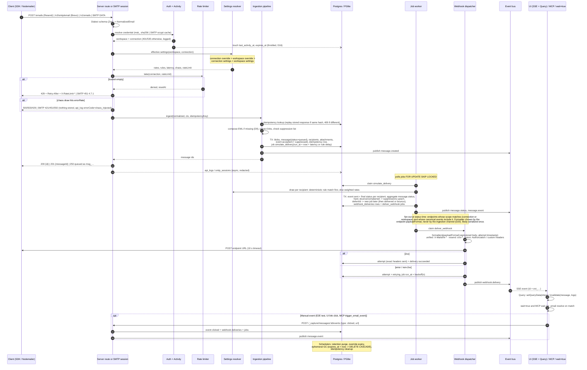

# 4. End-to-end sequence

Ingestion (API/SMTP) -> activity & TTL -> rate limit -> override/default resolution ->
status & storage -> signed webhook -> SSE / TanStack Query / MCP.

## Notes

- **Ordering guarantee**: one transaction writes the message and its first job, so a
  crash never leaves a message without its simulation, and the worker never sees a job
  whose message is not committed.
- **Latency semantics**: the HTTP/SMTP reply is immediate; `latency` and rule `delayMs`
  delay the transition from `queued` to the final status (what providers do). Chaos is
  the only knob that slows or fails the request itself (`chaos.slowMs` can be added later).
- **wait=true** subscribes to the bus *before* running the query, so a message committed
  between the query and the subscription is not missed.
- **Ephemeral GC** publishes `workspace.deleted` to close open SSE streams and MCP
  sessions of that workspace.
