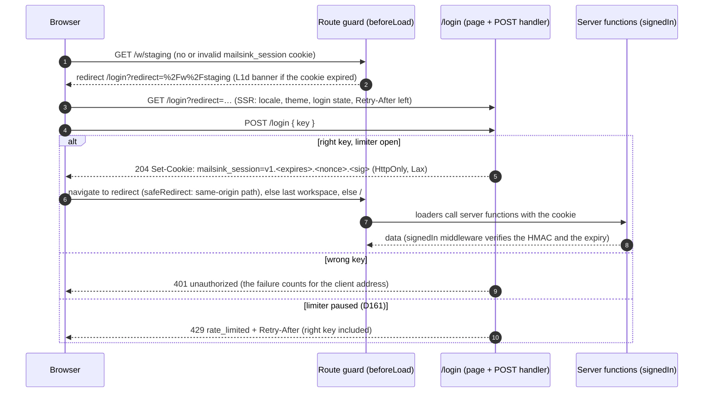
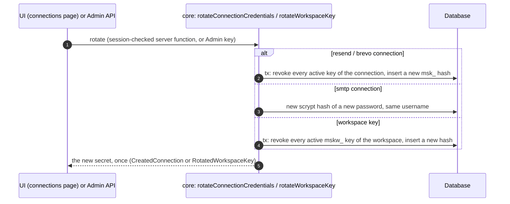

# 4. End-to-end sequence

Ingestion (API/SMTP) -> activity & TTL -> rate limit -> override/default resolution ->
status & storage -> signed webhook -> SSE / TanStack Query / MCP.

```mermaid
sequenceDiagram
  autonumber
  participant C as Client (SDK / Nodemailer)
  participant R as Server route or SMTP session
  participant A as Auth + Activity
  participant L as Rate limiter
  participant S as Settings resolver
  participant P as Ingestion pipeline
  participant DB as Postgres / PGlite
  participant Q as Job worker
  participant W as Webhook dispatcher
  participant B as Event bus
  participant U as UI (SSE + Query) / MCP / wait=true

  C->>R: POST /emails (Resend) | /v3/smtp/email (Brevo) | /v1/emails | SMTP MAIL FROM
  R->>A: resolve credential (msk_ sha256 | SMTP AUTH, scrypt cache)
  A-->>R: workspace + connection (401/535 otherwise, logged without body)
  R->>R: request log: mark the body as wanted (read once, D146, D157)
  A--)DB: touch last_activity_at, expires_at (throttled, D16)

  R->>S: effective settings(workspace, connection)
  Note over S: connection override > workspace override ><br/>connection settings > workspace settings
  S-->>R: rates, rules, latency, chaos, rateLimit
  R->>L: take(connection, rateLimit)
  alt bucket empty
    L-->>R: denied, resetAt
    R-->>C: 429 + Retry-After + X-RateLimit-* | SMTP 451 4.7.1 on MAIL FROM
    R--)DB: api_logs errorCode=rate_limited (async)
  end
  alt chaos draw hits errorRate
    R-->>C: 429/500/502/503 | SMTP 421/451/452/550 on MAIL FROM (nothing stored)
    R--)DB: api_logs errorCode=chaos_injected (async)
  end
  Note over R: SMTP: the guard runs on MAIL FROM, one token per transaction,<br/>before any byte of DATA is read (D132)
  R->>R: body (HTTP, capped) | DATA (SMTP) -> dialect schema (Zod) -> NormalizedEmail

  R->>P: ingest(normalized, ctx, idempotencyKey)
  P->>DB: idempotency lookup (replay stored response if same hash, 409 if different)
  P->>P: compose EML if missing (D9), extract links, check suppression list
  P->>DB: TX: blobs, message(status=queued), recipients, attachments,<br/>event accepted (+ suppressed), idempotency row,<br/>job simulate_delivery(run_at = now, D70),<br/>email.suppressed deliveries + deliver_webhook jobs (D153)
  P->>B: after commit: publish message.created (+ message.event suppressed, D81)<br/>and webhook.delivery per created delivery
  P-->>R: message ids
  R-->>C: 200 {id} | 201 {messageId} | 250 queued as msg_…
  R--)DB: api_logs / smtp_sessions (async: headers redacted, attachments stripped,<br/>bodies truncated, transcript capped, D145 to D147)
  R--)B: publish log.api | log.smtp (derived, no SSE id)

  Note over Q: polls jobs FOR UPDATE SKIP LOCKED
  Q->>DB: claim simulate_delivery
  Q->>S: first run: effective settings (overrides active now), per recipient<br/>rule match first, else weighted draw; status + delay (D70, D71)
  Q->>DB: TX (message locked): queued -> event sent, decisions in messages.simulation,<br/>aggregate message.status, follow-up job at the earliest pending decision,<br/>webhook_deliveries rows + deliver_webhook jobs of the run's events (D152)
  Note over Q: follow-up run, once a delay is over
  Q->>DB: TX: event + final status per due recipient,<br/>hard_bounce/complained -> suppressions upsert,<br/>deferred -> decided again 1 s + delay later (4th: soft_bounce, D72),<br/>next follow-up job if a decision is pending,<br/>automatic opened / clicked of the delivered recipients (D143),<br/>webhook_deliveries rows + deliver_webhook jobs (D152)
  Q->>B: after commit: message.event per written row, then message.status (D95),<br/>then the engagement events and one webhook.delivery per delivery (D144)

  Note over Q,W: fan-out at status time: endpoints whose scope matches (connection or<br/>workspace) and whose canonical events include it. Formatter chosen by the<br/>endpoint payloadFormat, never by the ingestion channel (D20). Body serialized once.
  Q->>W: claim deliver_webhook
  W->>W: formatters[payloadFormat].sign(stored body, attempt timestamp)<br/>unified: X-Mailsink-* · resend: svix-* · brevo: Authorization / custom headers
  opt MAILSINK_WEBHOOK_BLOCK_PRIVATE=true
    W->>W: resolve the URL host; a private, loopback or link-local address<br/>is a final failed attempt, nothing sent (D150, D155)
  end
  W->>C: POST endpoint URL (10 s timeout, redirects not followed)
  alt 2xx
    W->>DB: TX: attempt (exact headers sent) + delivery succeeded
  else error / non-2xx
    W->>DB: TX: attempt + retrying + next deliver_webhook job (backoff, 8 attempts, D138)
  end
  W->>B: publish webhook.delivery

  B-->>U: SSE event (id = evt_… for message events; none for derived frames)
  U->>U: Query: setQueryData(inbox) / invalidate(message, logs)
  U->>U: wait=true and MCP wait_for_email resolve on match

  opt Manual event (E2E test, UI link click, MCP trigger_email_event)
    U->>R: POST /capture/messages/:id/events {type: clicked, url} | {type: status, status}<br/>(or the MCP tool, origin mcp)
    R->>DB: TX (message locked): events (origin api), forced status + suppressions +<br/>aggregate (status only), webhook deliveries + jobs (D142)
    R->>B: after commit (core triggerAndPublishEvent, D180): message.event per event,<br/>message.status if it changed, webhook.delivery per delivery
  end

  opt Webhook test send and replay
    U->>R: POST /capture/webhooks/:id/test | POST /capture/webhooks/deliveries/:id/replay
    R->>DB: delivery (test: sample body, one attempt sent at once, D140;<br/>replay: deliver_webhook job, exact or resign, D139)
    R->>B: publish webhook.delivery
  end

  opt Override API (POST /capture/override, /capture/override/reset) or MCP override tools
    U->>R: activate or reset (optional TTL)
    R->>DB: TX: close the open override of the scope, insert the new one
    R->>B: publish override.changed (D96, from core, D180)
  end

  Note over DB: Schedulers: retention purge (messages, logs, finished webhook<br/>deliveries D154, failed jobs), override expiry (5 s, publishes<br/>override.changed, D96), ephemeral GC (30 s, expires_at < now -><br/>DELETE CASCADE, publishes workspace.deleted), idempotency cleanup
```

## Notes

- **Ordering guarantee**: one transaction writes the message and its first job, so a
  crash never leaves a message without its simulation, and the worker never sees a job
  whose message is not committed.
- **Latency semantics**: the HTTP/SMTP reply is immediate and the first job runs at once;
  `latency` and rule `delayMs` are per recipient, so they delay the transition from `sent`
  to the final status through follow-up jobs (D70), what providers do. Chaos is the only
  knob that slows or fails the request itself (`chaos.slowMs` can be added later).
- **Simulation files** (`packages/core/src/simulation/`): `simulate-delivery.ts` is one
  run (steps above); `settings-planner.ts` is the default `DeliveryPlanner`
  (`planner.ts`), it loads the four layers (`load-settings.ts`, `settings-resolver.ts`)
  and decides each recipient (`decide.ts`: `rules.ts` globs, then `draw.ts` with the
  `rng.ts` generator); `recorder.ts` writes statuses, events and suppressions;
  `aggregate.ts` derives the message status; `snapshot.ts` reads and checks
  `messages.simulation`. The job side is `jobs/handlers/simulate.ts` (payload, run) and
  `simulate-publish.ts` (frames of the rows the run returns, D95); `fan-out-run.ts`
  writes the automatic opened / clicked events and the webhook deliveries inside the run's
  transaction, and `jobs/handlers/simulate-webhooks.ts` publishes them after the commit
  (D152).
- **Webhook fan-out**: every write of `message_events` fans out in its own transaction:
  ingestion (`suppressed`, D153), a simulation run (D152) and manual events (D142).
  Nothing is lost between the event and its deliveries; a delivery is then attempted by
  its own jobs (D138), whatever happens to the endpoint afterwards (D141).
- **Duplicated follow-up job**: a crash between the commit of a run and the deletion of
  its job runs the job again; that replay writes no event but may enqueue a second
  follow-up job, which later completes without effect (doc 02, D99).
- **Request log** (#35): every call of a logged surface writes one `api_logs` row after
  its response is built, refused calls included (`unauthorized`, `rate_limited`,
  `chaos_injected`, validation errors); reading the logs and the SSE stream are not
  logged (D145); calls without workspace are read through `GET /admin/logs/api` (D151).
  The request body is read once: the bytes the handler buffered, else the unread body at
  response time (D157). The write is asynchronous and never fails the call; the runtime stop
  waits for the pending writes before closing the database. SMTP sessions are written by
  `recordSmtpSession` once the session ends.
- **Dev restart** (`vite dev`, D148): requests arriving while a restart is debounced or
  running wait for the new runtime; the restart waits up to 10 s for the requests still
  running on the old one (each keeps the runtime it started on), then stops it and boots
  the new code.
- **wait=true** subscribes to the bus *before* running the query, so a message committed
  between the query and the subscription is not missed.
- **Workspace deletion**: the ephemeral GC and `DELETE /admin/workspaces/:id` (D97) both
  publish `workspace.deleted`, which closes the open SSE streams and ends the `wait=true`
  calls of that workspace (404). MCP exchanges end the same way (D169): each `POST /mcp`
  subscribes to its workspace channel; on `workspace.deleted` a pending `wait_for_email`
  answers `not_found` at once, the calls still in flight get 1 s, then the server and its
  response stream are closed. Without deletion, the server is closed when the response
  ends or the client aborts (stateless: nothing outlives the exchange).

## Web UI sign-in (#37, D13, D160 to D163)



- The session is stateless (D160): nothing is stored server side; signing out deletes the
  cookie of this browser, rotating `MAILSINK_SESSION_SECRET` (or the admin key it derives
  from) signs everyone out.
- Client address of the limiter: the socket address, or the last `X-Forwarded-For` entry
  with `MAILSINK_TRUST_PROXY` (D182, D185).
- `MAILSINK_UI_AUTH=none`: no guard, `/login` redirects to the page asked for and
  `POST /login` answers 404.

## Web UI inbox in real time (#39, #40, D175, D178)

```mermaid
sequenceDiagram
  autonumber
  participant Br as Browser (inbox page)
  participant R as /w/$workspaceSlug/m/stream (session)
  participant B as Event bus
  participant Q as TanStack Query cache
  participant F as Server functions (signedIn)

  Br->>F: SSR loader: workspace (touched), facets, first inbox page, open message
  Br->>R: EventSource (cookie), Last-Event-ID or ?lastEventId= after a gap
  R->>B: subscribe(workspace), replay from message_events after Last-Event-ID
  B-->>R: frames (message.created, message.event, message.status, webhook.delivery…)
  R-->>Br: data: StreamEvent
  Br->>Q: applyStreamEvent: prepend message.created to matching lists, write statuses
  Br->>Q: invalidate only what the frame names (message.event and webhook.delivery:
  Note over Br,Q: the viewer of their messageId; log.*: facets), coalesced over 250 ms
  Q->>F: refetch the observed queries, previews of new rows in one batch
```

- `message.event` frames carry the `messageId` of their event (D205): only the viewer of
  that message refetches, other open viewers stay as they are.
- After a reconnection gap, derived frames (statuses, purges, deliveries) are not replayed,
  so every inbox query is refetched once (`onResync`).
- `workspace.deleted` ends the stream: the layout shows « This workspace was deleted »
  with a way back to the picker.

## Credential rotation (#38, #106, D172, D207)



- No grace period: the previous secret is refused by the next request (API keys are read
  from the database on every call; the SMTP credential cache is keyed by the stored hash).
- The UI keeps the new secret in memory until the page is left, with a copy button whose
  confirmation is a toast (D208); the Admin API answers it in its body.
